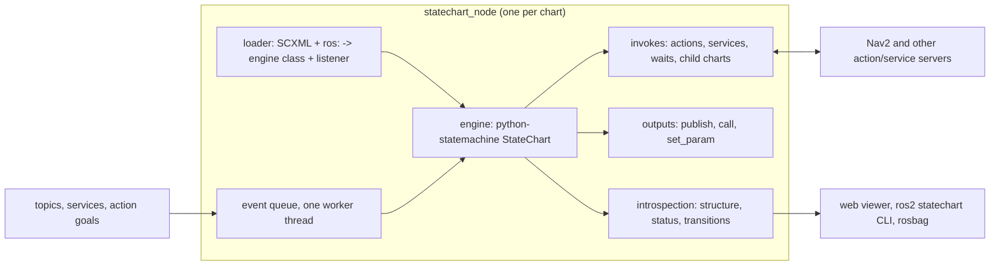

# Design

## 1. Goals and non-goals

**Goals**

- Write a robot's task and mode logic as one declarative document: standard
  SCXML for the states, a small `ros:` extension for what each state does in
  ROS ([FORMAT.md](FORMAT.md)).
- Get statechart guarantees from the engine, not from discipline: leaving a
  state cancels what it started, parallel regions stay independent, history
  is declared, events are processed one at a time.
- Integrate with Nav2 and with any package's actions, services and topics,
  without code beyond guards and builders.
- Make a running chart visible and debuggable: a web viewer, terminal tools,
  a transition log that rosbag records.
- Check charts before they run: the same validator at start-up and in CI.
- Use python-statemachine as released ([ENGINE.md](ENGINE.md)); no fork.

**Non-goals**

- Real-time control or anything on a control loop. Charts decide; servers
  and controllers execute. Event rates of tens per second are the design
  point.
- Safety functions. Emergency stops, speed limits and collision avoidance
  stay in hardware and in dedicated nodes that do not depend on a chart.
- Replacing behavior trees where they fit. Nav2's navigators and recoveries
  are behavior trees and stay so; a chart invokes them through their actions.
- A C++ API in version 1. C++ nodes interact through ROS interfaces.

## 2. Use cases

| Use | Chart |
|---|---|
| A mobile robot's mission | modes, safety and position as parallel regions; a task region that runs jobs step by step with Nav2 actions |
| A docking or pick procedure | a child chart invoked by the mission, or hosted as an action server by the node that owns the device |
| A cell controller | waits for parts, calls a robot arm's action, reports to a line controller |
| Teaching | small charts that show nesting, history and invoke on a simulated robot |

## 3. Architecture

One node hosts one chart (and its child charts). The mission of a robot is
one chart in one node: splitting parallel regions across nodes would turn
`In(...)` guards, run-to-completion and exit-before-entry into distributed
consistency problems. Other nodes are invoked, never governed: the chart
sends goals and cancels them; their internal behaviour (Nav2's behavior
trees, a docking server's states) remains theirs.

## 4. Execution model

- **One queue, one worker.** Every ROS callback (subscription, service
  request, action goal, timer, invoke feedback and result) puts an event on a
  single thread-safe queue. One worker thread takes events in order and
  calls the engine's `send`. The engine itself is never entered from two
  threads, so charts and models need no locks.
- **Executor.** The node spins a multi-threaded executor so that callbacks
  and action client futures complete while the worker processes an event.
  Blocking ROS calls are never made from the worker; invokes use the
  asynchronous client APIs.
- **Invokes.** The engine runs each invocation in its own thread
  (ENGINE.md E4, Q4). The engine would also process an invoke's result on
  that thread when the worker is idle (E14), so our handlers never hand
  their outcome to the engine: they send the goal with the async API, wait
  on the result future or on `ctx.cancelled`, put the outcome on the node's
  queue and then wait for `ctx.cancelled`. The worker sends
  `done.invoke.<state>` with the outcome, after checking that the invocation
  is still the current one of its state. On cancellation a handler requests
  the cancel and returns at once (the engine joins its thread on the
  worker); a per-server gate, released when the server confirms or after
  `cancel_timeout`, makes the next goal to that server wait in its own
  invoke thread, so a new goal never races the cancel of the old one.
- **Timeouts.** `ros:after` uses ROS timers, not delayed SCXML sends, which
  would hold the worker (E13).
- **Outcomes.** Handlers never raise for an expected failure: they return a
  status, result and error fields, and generated conditions route them
  ([FORMAT.md](FORMAT.md) section 4). An exception in user code becomes
  `error.execution`, which the chart may handle (for example by entering a
  fault state); an unhandled one is logged with the state and event.
- **Time.** The node uses ROS time (simulation time when `use_sim_time`).
  Delayed events and timeouts follow it.
- **Lifecycle.** The node is a managed (lifecycle) node:
  configure loads and validates the chart, activate starts it, deactivate
  exits all states (cancelling every invoke), cleanup drops it. A Nav2-style
  lifecycle manager or a launch file brings it up in order; with the
  parameter `autostart` (default true) the node configures and activates
  itself. To exit every state the standard way (exit actions, outputs,
  invokes), the loader wraps the chart's states in one compound state
  `sc_ros_root` with a transition to a final `sc_ros_stopped` on the event
  `sc_ros.stop`; the engine's own `stop()` would only cancel invokes. The
  chart's own top-level `<final>` ends there too, through
  `done.state.sc_ros_root`, and its donedata is kept as the run's result.
- **Parameters.** `chart` (path or `package://`), `autostart`,
  `debug_events`, `status_rate_max` (Hz, default 20; status changes in
  between are coalesced), `datamodel_publish` (names of datamodel values in
  the status), `run_as_action` (an action name: the node waits for
  `RunStatechart` goals instead of starting its chart on activation), and
  one parameter per `ros:param`.
- **Composition.** A chart grows in three ways, chosen by what the parts
  share:
  - *nested states and parallel regions in one chart* when the parts share
    data, guards or events: regions that read each other's state (`In()`)
    or one datamodel must stay in one chart, since two charts share
    nothing but events;
  - *a child chart in the same node* (`ros:chart`, [FORMAT.md](FORMAT.md)
    section 5) for a procedure with its own states that a parent runs as one
    step (docking, a recovery): it is reusable, testable on its own and
    stopped with the parent's state; it costs no process and no transport;
  - *a chart in another node* (`run_as_action` and `ros:action` on
    `RunStatechart`) when the procedure belongs with other software (a
    different machine, a driver's process, a separate lifecycle) or several
    parents use one instance. The action gives cancellation, feedback and a
    result for free, at the price of a goal round trip and of an action
    server that may be absent.
- **Testing without ROS.** The queue, worker, listener, invokes and outputs
  are one class, `ChartRunner`, which talks to ROS only through a host
  object; the node gives it a ROS host, tests a fake one.

## 5. Introspection

Package `statechart_ros_msgs`:

| Interface | Content |
|---|---|
| `msg/StatechartStructure` | chart name and source, states as a tree (id, kind, initial, history, `ros:` annotations: invoke kind and target, outputs), transitions (source, event, guard name, targets, kind), input events |
| `msg/StatechartStatus` | stamp, active configuration (ids), last event, last transition, refusal, selected datamodel values, invokes running (state, kind, target, since, last feedback summary) |
| `msg/Transition` | stamp, event and its data (JSON), source and target configurations, duration of the macrostep |
| `srv/SendEvent` | event name and JSON data; reply handled, refusal, configuration |
| `srv/GetStructure` | the structure on demand |
| `action/RunStatechart` | run a chart as an action: goal (chart, initial data), feedback (status), result (final state, donedata) |

Topics of a node `<name>`: `~/structure` (latched), `~/status` (latched, on
every change), `~/transitions`. Services: `~/get_structure`, and
`~/send_event` only when the parameter `debug_events` is true (default false;
meant for simulation and tests). Because these are ordinary topics, a rosbag
of a run contains the whole history of the chart.

## 6. Web viewer

`statechart_ros_viewer` is a node that discovers charts (by their
`~/structure` topics) and serves one web page.

- **Diagram** from the structure: nested and parallel states laid out with a
  hierarchical graph layout in the browser; each state shows its invoke
  (for example `dock_robot` with type) and outputs as small labels.
- **Live state**: active states highlighted, the running invoke with its
  elapsed time and last feedback, the last transition animated, refusals
  shown.
- **Log**: transitions with event, data and time; click to see the
  configuration at that moment.
- **Data**: the datamodel values the status publishes.
- **Debug** (only when the chart's `debug_events` is on): send an event from
  a list of the chart's input events.
- **Replay**: playing a rosbag (`ros2 bag play`) drives the same page, for
  analysing a run after the fact.

The page is static files plus a small HTTP and server-sent-events endpoint in
the node: no rosbridge and no build tools on the robot. The layout is dagre
(MIT, vendored with its licences); the page loads nothing from outside the
viewer. A Foxglove panel can reuse the page's components later. Guide:
[VIEWER.md](VIEWER.md).

## 7. Command line: `ros2 statechart`

| Verb | Does |
|---|---|
| `validate <chart>` | all checks of [FORMAT.md](FORMAT.md) section 6; exit code for CI |
| `diagram <chart> -o out.svg\|.md` | Mermaid, Graphviz or a Markdown transition table, with `ros:` annotations |
| `export --plain <chart>` | the expanded, extension-free SCXML for other tools |
| `list` | running charts |
| `show <node>` | active configuration as a tree, running invokes |
| `echo <node>` | transitions as they happen |
| `send <node> <event> [json]` | a debug event (needs `debug_events`) |

## 8. Nav2 integration (`statechart_ros_nav2`)

Reference: [NAV2.md](NAV2.md).

- **Kinds** for `ros:invoke`: `nav2/navigate_to_pose`,
  `nav2/navigate_through_poses`, `nav2/follow_waypoints`, `nav2/dock`,
  `nav2/undock`, `nav2/spin`, `nav2/back_up`, `nav2/wait`, each with typed
  attributes (poses by name from the datamodel or from the YAML file of the
  node parameter `named_poses`, dock id or pose, staging, distances) so most
  charts need no goal builder; a `goal` builder still completes the goal.
- **Error codes** of each Nav2 action mapped to names in the outcome data
  (`error_name`, plus `error_source`, the action declaring the code, since a
  navigator reports the code of a failing behavior-tree action), read from
  the installed `nav2_msgs`, so a guard can test `failed_to_detect_dock`
  instead of 904.
- **`nav2/active`**: an invoke that succeeds once Nav2's lifecycle managers
  (`<manager>/is_active`) report their nodes active, for an initialisation
  state.
- **Feedback** summarised into the status (distance remaining, recoveries,
  docking phase) for the viewer.
- **Division of work**: recoveries, replanning and the docking procedure stay
  in Nav2. A chart decides which goal to send and what to do with its
  outcome.
- **Simulation**: the example and the nightly tests use Nav2's TurtleBot3
  loopback simulation (`nav2_loopback_sim`: no Gazebo, so it runs on CI
  machines without a GPU), with one dock added to the docking server's
  parameters and dock detection off.

## 9. Extending with user packages

- **Invoke kinds** from any package through the Python entry point group
  `statechart_ros.invokes` (`kind` name to a handler class declaring its
  attributes, statuses and how it cancels). `statechart_ros_nav2` is built on
  the same mechanism.
- **Models** are ordinary Python classes in the user's package.
- **Charts** are package data, referenced as `package://pkg/charts/x.scxml`.

## 10. Testing (`statechart_ros_testing`)

- Load a chart with fake invoke kinds whose outcomes are scripted per state
  ("the first dock attempt aborts, the second succeeds").
- Scenario tests: a list of events and expected configurations, without ROS.
- Property tests with Hypothesis: random event sequences, invariants checked
  after every macrostep (written as Python predicates on the configuration
  and datamodel).
- `launch_testing` helpers to run a chart against real servers in
  simulation and assert on its status topic.

## 11. Security

Charts load in the engine's restricted datamodel: no function calls, no
`<script>`, no external `src` (ENGINE.md E11). Code lives only in the model
and in invoke kinds, which are Python packages installed like any other.
`debug_events` is off by default.

## 12. Packaging and releases

- ROS 2 Humble (Python 3.10), Jazzy (Python 3.12) and Rolling are
  supported: CI builds and tests every package on all three on every push
  (Nav2 in simulation runs nightly on Jazzy). Packages that need a newer
  ROS interface than Humble has (the Nav2 docking server, error codes in
  Nav2 results) say so and skip those tests there. Rolling has no Nav2
  binaries, so `statechart_ros_nav2` is built and tested on Humble and
  Jazzy only. On Humble, rclpy's executor raises `InvalidHandle` when an
  entity is destroyed while it waits (as a lifecycle cleanup does);
  `statechart_ros.spin.spin` retries, and the node's `main` uses it.
- python-statemachine is not in Ubuntu, and the ROS buildfarm does not allow
  pip dependencies for binary packages, so `python_statemachine_vendor`
  ships a pinned release; the version is raised only with the engine probes
  passing.
- Semantic versioning; the `ros:` namespace URI carries the format's major
  version (`.../ns/1`).

## 13. Decisions

| Decision | Choice | Why |
|---|---|---|
| Engine | python-statemachine, unpatched | full SCXML semantics (invoke, history, parallel, run-to-completion), maintained, MIT |
| Format | SCXML plus `ros:` elements in the document | one file shows states and what they do; SCXML extension points; standard tools still read it |
| ROS bindings placement | direct children of `<scxml>` and states | where both the W3C schema and the engine accept them |
| Code | Python model, by name | declarative documents, restricted datamodel |
| Expression language | a Python subset, validated (FORMAT.md section 8) | the team writes Python; launch files evaluate Python; ECMAScript rejected for its coercions; CEL possible later as a second language through generated callbacks |
| Unhandled events | an error unless refused or ignored | a robot must answer every command |
| Process structure | one chart per node; other nodes invoked | statechart guarantees need one configuration and one queue |
| Composition | child charts in the same node (`ros:chart`, own queue, stopped with the invoking state) or in another node through `RunStatechart` | a procedure reused as one step, cancelled like any invoke; sharing data or guards stays one chart |
| Viewer | web page served by a node | works on any machine with a browser |
